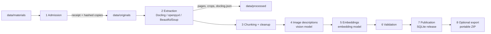
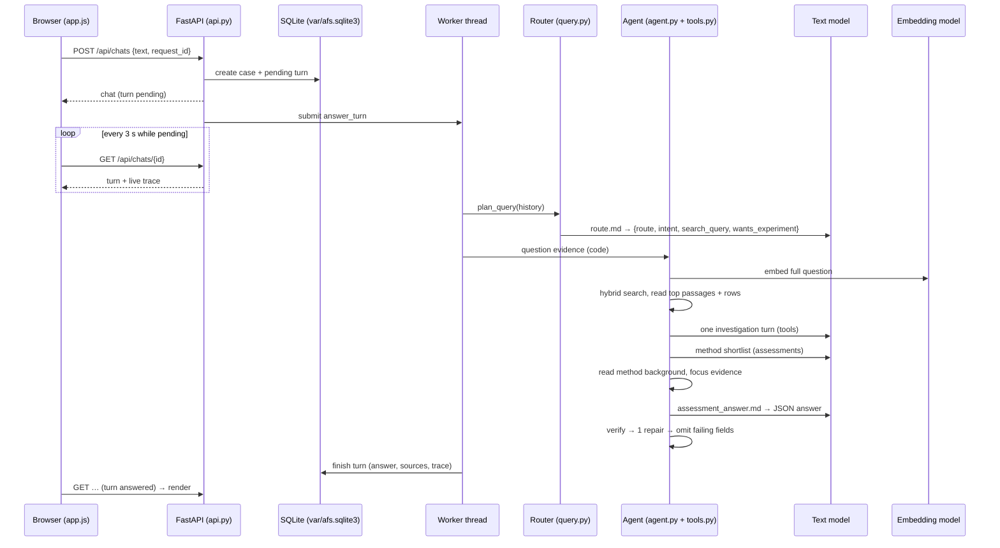

# AFS Assistant — Architecture

This document describes how the AFS Assistant works from end to end: how the
supplied documents become a searchable index, how a question travels through
the system, which libraries and models are used at each step, and where every
piece of data lives.

For installation and day-to-day commands see the [README](../README.md).

---

## 1. What the system does

A customer describes a measurement problem ("we want to monitor moisture in a
polymer melt inline…") or asks a narrow technical question. The assistant:

1. decides whether the message is a technical question, a full customer
   assessment, small talk or out of scope;
2. retrieves evidence from the supplied AFS knowledge sources (PDF papers,
   slides, flyer, method-comparison workbook, laboratory web page);
3. lets an LLM agent fill one concrete evidence gap with Python tools;
4. writes a structured, cited answer — for an assessment: requirements,
   candidate methods with claims, limitations, open questions, risks and a first
   feasibility study;
5. checks the answer in code (quotes, citations, quantities, method/geometry
   consistency), repairs it once, and removes any field that still fails;
6. shows the answer in a web UI where every citation opens the exact chunk, the
   rendered PDF page, the figure crop or the workbook row.

There are two separate phases:

| Phase | When it runs | Needs | Output |
| --- | --- | --- | --- |
| **Preparation** (offline) | Once per document set | Docling, vision model, embedding model | Immutable evidence *release* in SQLite + page images / crops on disk |
| **Runtime** (online) | Every chat message | Text model, embedding model (query only), optional vision | Cited answer stored in SQLite |

A prepared release can be exported to a portable ZIP and installed elsewhere,
so a new machine never repeats preparation.

---

## 2. Technology stack

| Concern | Technology |
| --- | --- |
| Language / packaging | Python ≥ 3.11, `uv` (locked via `uv.lock`), `hatchling` |
| Web API | FastAPI + Uvicorn (single process, loopback only) |
| Web UI | Plain HTML/CSS/JavaScript, no build step (`src/afs_assistant/web/`) |
| PDF parsing | Docling ≥ 2.94 (layout model *docling-layout-heron*, TableFormer, RapidOCR) |
| Other formats | `openpyxl` (workbook), BeautifulSoup (web page), `pypdf` (page text / bibliography) |
| Sentence splitting / token counting | spaCy blank multilingual model + `sentencizer` (no downloaded weights) |
| Lexical search | `rank-bm25` (BM25Okapi) with a technical tokenizer |
| Semantic search | Stored passage embeddings + cosine similarity in Python |
| Fusion | Reciprocal Rank Fusion (RRF) |
| Agent | LangChain `create_agent` on LangGraph, with custom middleware |
| Agent checkpoints | `langgraph-checkpoint-sqlite` (`var/agent-checkpoints.sqlite3`) |
| Model transport | `httpx` for OpenAI-compatible endpoints; `anthropic` SDK for Claude |
| Chat models | `langchain-openai` (`ChatOpenAI`) or `langchain-anthropic` (`ChatAnthropic`) |
| Schemas / validation | Pydantic v2 (all records, tool schemas and the answer schema) |
| Storage | SQLite (WAL mode) |
| Tests / types | pytest, pyright |

### Models used for the current index

| Role | Model | Setting |
| --- | --- | --- |
| Text (routing, agent, answer) | `qwen3.6:35b-a3b` | `AFS_MODEL` |
| Embeddings (1024-dim) | `qwen3-embedding:0.6b` | `AFS_EMBEDDING_MODEL` |
| Vision (figure descriptions, live figure inspection) | `gemma4:31b-it-qat` | `AFS_VISION_MODEL` |

Any OpenAI-compatible server (Ollama, vLLM, OpenAI, …) works for text and
vision. Setting `AFS_PROVIDER=anthropic` routes text and vision to Claude via
the Anthropic SDK; embeddings always go to an OpenAI-compatible
`/embeddings` endpoint. **The query-embedding model must be the one the index
was built with**, otherwise hybrid search is refused.

---

## 3. Repository map

```
src/afs_assistant/
├── cli.py                 Command-line entry point (afs-assistant …)
├── config.py              Settings loaded from .env + environment, validated
├── api.py                 FastAPI app: chats, sources, exports, static UI
├── core/
│   ├── models.py          Pydantic records: sources, chunks, corpus, answer schema
│   ├── storage.py         SQLite store: releases, chats, turns
│   ├── gateway.py         Model transport (embeddings, JSON answers, vision)
│   ├── lexical_index.py   BM25 index + tokenizer
│   ├── embeddings.py      Vector sanity checks
│   ├── citations.py       Field paths, citation markers, numbering
│   ├── source_policy.py   Decorative-image filter, figure/caption linking
│   ├── reporting.py       Markdown export of an assessment
│   ├── tool_schema.py     Self-contained JSON schemas for providers
│   └── fingerprints.py    Deterministic SHA-256 identities for caches
├── indexing/              Offline preparation pipeline
│   ├── official.py        Admission of the supplied files, format-aware extraction, cleanup
│   ├── extractor.py       Docling conversion (pages, elements, crops, OCR)
│   ├── chunking.py        Section-aware sentence chunking, atomic table rows / images
│   ├── image_processor.py Vision descriptions for figure crops
│   ├── builder.py         Orchestrates extract → chunk → describe → embed → publish
│   ├── material_cache.py  Extraction / chunk / description / vector caches
│   ├── references.py      Bibliography extraction and cross-source linking
│   ├── ingestion.py       Loads the admission receipt and verifies hashes
│   ├── bundle.py          Export / install of the portable index ZIP
│   ├── publication.py     Ingest of a normalized JSON corpus (demo / tests)
│   ├── curated_transcriptions.json  Manual transcriptions of image-only content
│   └── prompts/describe_image.md
├── retrieval/
│   ├── retriever.py       Hybrid search, context, figure lookup
│   └── fusion.py          Reciprocal Rank Fusion
├── workflow/              Runtime answering
│   ├── chat.py            Entry point: figure shortcut, demo mode, agent
│   ├── query.py           Router (route / intent / search query)
│   ├── agent.py           Investigation + answer generation + validation loop
│   ├── tools.py           Agent tools and evidence bookkeeping
│   ├── verify.py          Quantity / unit / method / geometry checks
│   ├── omission.py        Removes individually failing fields after repair
│   ├── context.py         Sentence-boundary clipping
│   └── prompts/           route, investigate, method_shortlist, assessment_answer
├── fixtures/demo.json     Synthetic evidence for offline demo mode
└── web/                   index.html, app.js, style.css
scripts/run_scenarios.py   Runs the organizer scenarios through the real API
tests/                     unit, integration, connectivity
data/                      Materials, index bundle, prepared assets (see §8)
var/                       Runtime databases (ignored by Git)
results/                   Final generated assessments for H01–H06
```

---

## 4. Preparation pipeline (offline)

Command:

```sh
uv run --extra ingestion afs-assistant prepare-official \
  --release afs-official-v2 --describe-images --embed --publish
```



### 4.1 Admission — `indexing/official.py::admit_official`

* Reads exactly the six supplied knowledge files listed in `OFFICIAL_FILES`
  (S01–S05 PDFs and `AFS_method_comparison_table.xlsx`), plus the S06 laboratory
  web page whose URL comes from `S06_Laboratory_Link.txt`. The page is fetched
  once and re-used from its retained snapshot afterwards.
* Each file is copied to `data/originals/<sha256>/<filename>`; a mismatching
  existing copy aborts.
* A receipt `data/originals/official-materials.json` records, per source: ID,
  title, hash, format, page count, role (`technical`, `research`, `business`),
  visual strategy (`regions` for papers, `page` for slides/flyer), DOI keys for
  cross-referencing and table pages.
* Organizer scenarios and worked answers (`AFS_Examples_and_Reference.docx`,
  `customer_scenarios_for_final_evaluation.txt`) are **never** admitted as
  evidence. Only the "answer structure" guidance section of the docx is written
  separately (`data/guidance/organizer-guide.json`); it is not searchable.

`ingestion.py::load_materials` re-reads the receipt, checks file signatures
(`%PDF-`, ZIP, HTML) and SHA-256 hashes and rejects duplicates.

### 4.2 Extraction — `indexing/extractor.py`, `OfficialExtractor`

**PDFs** go through Docling with:

* table structure recognition, page images and picture images enabled;
* integrated RapidOCR (English, small models) — `pdf_aware_layout_regions` for
  papers, `full_page` for slide decks;
* image scale 2.0 for the official material.

The extractor saves for every source, under
`data/processed/<source-sha256>/<processing-key>/`:

| File | Content |
| --- | --- |
| `page-N.png` | Rendered page (shown in the source viewer) |
| `element-N.png` | Crop of each figure/table element |
| `element-9000NN.png` | Whole-slide image (slide decks) |
| `docling.json`, `docling_artifacts/` | Canonical Docling document |
| `document.md` | Docling Markdown export |
| `material.json` | Extracted elements with page and bounding-box provenance |
| `coverage.json` | Native / OCR character counts per page |
| `reference-registry.json` | Parsed bibliography |

Then the official policy refines the elements:

* page headers/footers, bibliography entries and duplicate text are removed;
* repeated logos (same pixel hash) and tiny images (< 90×55 px) are dropped;
* **papers (`regions`)**: OCR lines not already present in the text layer are
  added as a per-page `ocr-labels` element (figure labels, axis text);
* **slides (`page`)**: each slide becomes a heading ("Slide N: …"), one
  flattened text element (layout text + recovered OCR) and one whole-slide
  image element; a slide with < 25 characters aborts the run;
* unresolved `[N]` markers inside images become reference records.

**Workbook** (`openpyxl`): each of the 19 rows of sheet `method_comparison`
becomes one element carrying its structured values, cell range
(`A{n}:I{n}`) and the sheet notes as qualifications.

**Web page** (BeautifulSoup): scripts, navigation, header and footer are
removed; headings, paragraphs and list items become text elements.

**References** (`references.py`): numbered and bulleted bibliographies are
parsed with `pypdf` page text; DOIs/URLs are extracted; a citation that
matches another supplied source's DOI key is linked (e.g. S04 reference 14 →
S03).

### 4.3 Chunking — `indexing/chunking.py`, `OfficialChunker`

* **Section-aware**: titles and section headers open a new section; each chunk
  carries its `heading_path` and a `parent_context_id` pointing to the full
  section text (used for "read adjacent passages").
* **Prose**: spaCy sentencizer splits sentences; sentences are packed up to
  **128 spaCy tokens** (`AFS_CHUNK_SIZE`). A single longer sentence is split at
  token boundaries, never dropped.
* **Tables**: Docling Markdown tables are split into one chunk per row, each
  repeating the header row (atomic, may exceed 128 tokens). Unresolvable tables
  stay whole.
* **Images**: each figure becomes its own `image` chunk containing the
  caption and nearby text (nearby text is omitted for whole slides, whose OCR is
  already indexed).
* **Workbook rows**: one chunk per row, `kind=method_comparison`, citation label
  "S01 Table 1 (p.6)" because the workbook mirrors that table.
* **Web page**: paragraphs are joined and re-split by sentence.
* **Cleanup** (`OfficialChunker._clean`): boilerplate lines (logos, credits,
  running headers) are removed; chunks with fewer than three words, or that are
  heading-only, are dropped; image-only content that OCR could not read is
  replaced with entries from `curated_transcriptions.json` (manual, labelled
  transcriptions of the supplied page).

Every chunk is an `EvidenceItem` with a stable `evidence_id`
(`<source>_<sha256 prefix>` of source hash, chunker version, settings, element
IDs and text), locator (`PDF p. 6`, `method_comparison!A5:I5`), provenance
(page + bounding boxes), element type and qualifications.

### 4.4 Image descriptions — `indexing/image_processor.py`

For every `image` chunk the vision model receives the PNG crop (JPEG-downscaled
above 600 kB), the document title, caption and nearby text, and the prompt
`indexing/prompts/describe_image.md`. The prompt asks for what is visible
(chart type, axis labels, legends, qualitative patterns) and forbids guessing
values off curves.

* Descriptions are validated (30–6000 chars, no repetition loops, no "cannot
  see the image") and cached in `data/cache/image_descriptions/<key>.json`;
  the key covers model, prompt hash, image hash and context.
* If the provider hits its output-token limit, the same model is retried once
  with reasoning disabled; the fallback is recorded.
* Sentences that read numerical positions off curves are excluded from the
  searchable text (`source_policy.visual_search_text`) and a review note is
  attached.
* The chunk text is rewritten to "Image from …, Caption: …, AI-generated visual
  description (unreviewed): …" and gets a new evidence ID.
* `AFS_VISION_WORKERS` (1–4) bounds parallel calls.

### 4.5 Embeddings — `builder.py` + `core/gateway.py::embed`

All chunk texts (including enriched image chunks) are embedded in batches of
`AFS_EMBEDDING_BATCH_SIZE` through `POST {embedding base}/embeddings`. Vectors
are checked (count, dimension, finite, non-zero) and cached in
`data/cache/vectors/<key>.json`; the key covers the chunk set, model, endpoint
and dimension.

### 4.6 Caching and resumability

Each stage has its own content-addressed cache, so a re-run only redoes what
changed:

| Stage | Location | Invalidated by |
| --- | --- | --- |
| Extraction | `data/processed/<hash>/<key>/` | Docling version, OCR mode, image scale, extractor version |
| Chunks | `data/cache/chunks/` | Chunker version, chunk size, strategy, spaCy version, source metadata, curated transcriptions |
| Image descriptions | `data/cache/image_descriptions/` | Vision model, prompt, image pixels, context |
| Vectors | `data/cache/vectors/` | Chunk content, embedding model, endpoint, dimension |

A run report is written to `data/runs/<release>/<timestamp>.json`. A failed
source marks the run failed and **nothing is published**; the previously
active release stays in place.

### 4.7 Validation and publication

`OfficialExtractor.validate_corpus` requires: all seven sources; coverage for
all 64 PDF pages; 20 slides each with ≥ 25 characters; OCR recovery of the
image-only slide 20 infographic; 19 workbook rows with cell ranges; 43
references for S03 and 25 for S04; the S04→S03 reference link.

`Store.publish` then writes the release in one SQLite transaction:

* table `releases(id, digest, corpus, model, vectors)` — the full corpus JSON
  and its vectors (the "semantic database");
* table `current_release` — which release is active.

Release IDs are immutable: publishing different content under an existing ID
is refused. Preparation also writes a JSON copy to
`data/releases/<release>/corpus.json`; nothing reads it and it can be deleted.

The **lexical index** is not stored; BM25 is rebuilt in memory from the corpus
texts when a release is loaded (memoised per corpus).

The current release `afs-official-v2` has **392 chunks** (S01 105, S02 61,
S03 146, S04 48, S05 7, workbook 19, web page 6) and **57 described images**.

### 4.8 Portable index — `indexing/bundle.py`

`export-index` writes a ZIP containing:

* `seed.sqlite3` — a fresh database with only the active release (corpus +
  vectors), no chats, no checkpoints;
* `data/originals/…` — the retained source files;
* `data/processed/…` — every page image and crop the corpus references;
* `data/guidance/organizer-guide.json` if present;
* `manifest.json` — format, release, embedding model and dimension, record
  count and the SHA-256 and size of every file.

Provider endpoints/keys are stripped from the processing metadata.

`install-index` verifies everything before writing: manifest format, exact
file list, per-file checksums, safe paths, SQLite integrity, absence of chat
rows, single active release, embedding model/dimension matching `.env`. It
refuses to overwrite an existing database or a differing data file, copies the
assets into `AFS_DATA_DIR` and atomically installs the database at
`AFS_DATABASE`. No document is re-embedded.

The shipped bundle is `data/index/afs-official-v2.zip` (checksum in
`data/index/SHA256SUMS`).

---

## 5. Runtime: from message to answer



### 5.1 API and sessions — `api.py`

* `serve` starts Uvicorn on `127.0.0.1` only; `TrustedHostMiddleware`
  restricts hosts to localhost.
* A browser gets a random 64-hex `afs_session` cookie (HttpOnly,
  SameSite=Strict). Only its SHA-256 is stored as the chat owner; every chat,
  source and export lookup is scoped to that owner.
* POST bodies must be JSON, ≤ 32 kB and not cross-site. Responses carry a strict
  CSP, `nosniff`, `no-referrer` and `no-store`.
* Answers run on a 2-worker thread pool (`AFS_BACKGROUND_ANSWERS=true`); the
  turn is `pending` while its trace is updated live. One pending turn per chat
  is enforced by a unique index. Revisions prevent stale submissions; a failed
  latest turn can be retried. On restart, pending turns become `failed`.

Endpoints:

| Method + path | Purpose |
| --- | --- |
| `GET /api/health` | Mode, active release |
| `GET /api/chats` | The owner's last 50 chats |
| `POST /api/chats` | New chat + first question |
| `GET /api/chats/{id}` | Chat with turns, answers, traces |
| `POST /api/chats/{id}/messages` | Follow-up question |
| `POST /api/chats/{id}/turns/{turn}/retry` | Retry a failed answer |
| `GET …/sources/{evidence}` | Cited chunk + URLs for page, crop, original |
| `GET …/sources/{evidence}/page` · `/image` · `/original` | Page PNG, figure crop, hash-verified original file |
| `GET …/turns/{turn}/export?format=md\|json` | Downloadable assessment |

Sources can only be opened if they were cited in that turn.

### 5.2 Entry point — `workflow/chat.py`

1. **Figure shortcut**: "show figure 3 of S03" is resolved directly to the
   matching image chunk without any model call.
2. **Demo mode** (`AFS_MODE=demo`): no model calls; answers from synthetic
   fixture evidence only.
3. Otherwise the `AgentResponder` runs.

### 5.3 Routing — `workflow/query.py` + `prompts/route.md`

One JSON-schema call classifies the **latest** user message (earlier user
messages only resolve references; assistant text is never used as customer
fact):

* `route`: `technical` · `out_of_scope` · `social` · `clarify`
  (non-technical routes return a fixed short reply);
* `intent`: `qa` (narrow question) or `assessment` (customer use case);
* `search_query`: a self-contained query with resolved pronouns;
* `wants_experiment`: whether a study was explicitly requested.

The investigation also refuses to run unless the active release consists of
the supplied (`authority=provided`) sources.

### 5.4 Retrieval — `retrieval/retriever.py`

Every search runs two routes over the eligible chunks (not disputed, not a
decorative logo image; optionally filtered by source, element type or role):

1. **Lexical**: BM25Okapi over a tokenizer that keeps technical tokens
   (`cm-1`, `316L`, `UV-Vis`, single-letter labels, negations) and removes
   English stop words; Robertson IDF keeps scores positive. Top
   `AFS_CANDIDATE_LIMIT` (30) with score > 0.
2. **Semantic**: the query is embedded once; cosine similarity against stored
   passage vectors; candidates must have cosine ≥ `AFS_MIN_SIMILARITY` (0.4);
   top 30.

Both rankings are merged with **Reciprocal Rank Fusion**,
`score = Σ 1 / (k + rank)` with `k = AFS_RRF_K` (60). Each hit reports its
BM25 score, cosine, fused score and which routes found it. Scores rank
candidates only; they are never treated as proof of relevance.

### 5.5 Investigation — `workflow/agent.py` + `workflow/tools.py`

**a. Question evidence (code, no model call).** The customer's full wording
(all user messages) is searched twice — passages (text / captions / images)
and workbook rows separately so rows cannot crowd out text. Up to **4
passages** (one per page, text preferred over the page's image) and **2
rows** are *read*; up to 8 further hits are returned as unread previews. This
is injected as the first `search_knowledge` observation, so it is checkpointed
like any tool call.

**b. One agent turn.** A LangChain agent (system prompt
`prompts/investigate.md`) gets exactly **one** model turn (`AGENT_TURNS = 1`)
to close a concrete gap, using these tools:

| Tool | What it does |
| --- | --- |
| `search_knowledge` | Hybrid search with optional source/type/role filters; on the last turn the top 2 passages are read automatically |
| `read_evidence` | Reads one or up to six returned references (`E1`, `E2`…), optionally with adjacent passages of the same section, each with its own reference |
| `lookup_method_table` | Reads workbook rows for method families (NIR, MIR/ATR, Raman, fluorescence, UV-Vis) |
| `inspect_figure` | Returns an image chunk; with a visual question, sends the actual crop to the vision model |
| `get_source_outline` | Lists sources, or headings/pages/images of one source |
| `lookup_references` | Bibliography metadata of a source (metadata only, not evidence) |

`InvestigationBudget` middleware enforces the limits: total model calls
(`AFS_MAX_MODEL_CALLS`, default 8, with 2–3 reserved for the answer, repair and
method shortlist), tool calls (`AFS_MAX_TOOL_CALLS`, 12), wall-clock time
(`AFS_RUN_TIMEOUT`, 300 s, keeping 30–100 s for the answer) and the read
evidence size (`AFS_EVIDENCE_BYTE_BUDGET`, 24 000 bytes of JSON). It forces a
tool call when nothing has been read yet (retrying once if a provider ignores
`tool_choice`), and forces `read_evidence` on the last turn if only previews
were seen. Identical calls repeated more than twice are refused.

Every read passage gets a short alias (`E1`…). Tool records add scope notes,
e.g. "flattened OCR is discovery text", "table ratings are qualitative; optical
depth is not spectral range", "company material is not experimental
validation", "AI image description is unreviewed". Heading-only chunks are
never counted as read evidence.

Agent state is checkpointed in `var/agent-checkpoints.sqlite3` per
`owner:chat:turn:release`; a retried turn resumes from the stored observations
and aliases are rebuilt only from tool outputs, never from model text.

**c. Method background (assessments).** A small JSON call
(`prompts/method_shortlist.md`) lists the methods the answer will propose
(NIR, MIR/ATR, Raman, Fluorescence, UV-Vis). For each, code reads — in tiers
across all methods — the method's own S01 section (§5.1–5.4), then S01
capability paragraphs, then up to two process-interface rows from the
workbook (probes first, cuvettes excluded). Each method's first section
passage is *protected*. An extra 8 000-byte headroom is reserved for this step.

**d. Focus.** If more than 12 passages were read, all read passages are ranked
by cosine similarity of their stored vectors to the full question (one query
embedding). The best **12** plus protected passages are kept; the rest are
removed so they cannot be cited.

### 5.6 Answer generation — `prompts/assessment_answer.md`

One JSON-schema call (`max_tokens` 5000, optional
`AFS_ANSWER_REASONING_EFFORT`) receives the inspected evidence, earlier and
latest customer messages, routed intent and the output schema. The schema is
tightened in code:

* `evidence_ids` may only take the aliases actually read (enum);
* for assessments, `assessment` and `assessment.experiment` are required and
  the study needs an objective, ≥ 1 step and ≥ 1 criterion;
* for Q&A, `assessment` must be `null`.

Answer structure (`core/models.py::ChatAnswer`):

* `parts[]` (≤ 8): `answer` (cited findings), `proposal`, `question`, `gap`;
* `citations[]`: field-level references for structured prose fields;
* `assessment`: `status`, `summary`, `requirements[]` (each with an exact
  `user_quote`), `candidates[]` (name, `claims[]` with evidence,
  assumptions, limitations, measurement concept, spectral range),
  `questions[]`, `unknowns[]`, `gaps[]`, `experiment` (objective, steps,
  criteria to confirm).

Proposals in a Q&A answer are dropped unless an experiment was requested.

### 5.7 Verification, repair and omission

After each generation, code checks:

* **Structure** (`agent.py::structure_issues`): intent matches; every `answer`
  part has evidence; not only questions; each requirement quotes the customer
  verbatim; the study is complete; a `ready_for_review` assessment has
  candidates; field citations point to existing prose fields; only inspected
  references are cited.
* **Quantities** (`verify.py`): every value + unit in a field must appear, with
  a compatible unit, in that field's cited passages (length, wavenumber, time,
  volume, mass, molarity, %, °C, ppm, dB…). Study counts, concentrations and
  thresholds must come from the customer, not from a source's published setting;
  workbook optical depth can never justify a wavelength range; a single source
  setting (e.g. one excitation wavelength) is not presented as the customer's
  configuration.
* **Consistency** (`verify.py::consistency_issues`): a cited passage must
  concern the same method family (NIR / MIR / Raman / fluorescence / UV-Vis) and
  sampling geometry (reflection, transmission, ATR, cuvette) as the field it
  supports; laboratory cuvette rows cannot support process probes.

If anything fails, the model gets **one repair** with the exact validator
messages (or a "be more concise" instruction after a truncated answer). If the
repaired answer still has isolated failures, `omission.py` removes each
failing paragraph, claim or list item **whole** — it never rewrites text or
attaches a different source, and refuses when a required list would become
empty. Unmatched requirement quotes are removed the same way. If the answer is
still invalid the turn fails with `answer_validation`.

Finally the `E` aliases are mapped back to evidence IDs, inline markers become
reader-facing source numbers, and `citation_status` is set to `present`,
`present_with_gaps` or `none`. A `completed` trace event records model/tool call
counts, stage timings, model names and a fingerprint of all prompts.

### 5.8 Web UI — `web/`

* Sidebar of the owner's chats; new chat; follow-ups in the same conversation.
* Live activity panel from the turn trace (routing, searches, reads, checks).
* Assessments render as sections: summary, requirements, candidates with
  claims/limitations, questions, risks, first feasibility study.
* Every citation opens a source card: chunk text, workbook rows as a labelled
  table, figure crop, rendered PDF page, and a link to the original file at the
  page.
* "Download this assessment" → Markdown (`core/reporting.py`) or JSON.
* Retry button for a failed latest turn.

---

## 6. Data stores

| Store | Path | Contents |
| --- | --- | --- |
| Main database | `var/afs.sqlite3` (`AFS_DATABASE`) | `releases` (corpus JSON + vectors per release), `current_release`, `cases` (chats), `chat_turns` (question, answer, cited sources, trace), `chat_starts` (idempotent creation) |
| Agent checkpoints | `var/agent-checkpoints.sqlite3` | LangGraph message state per turn |
| Retained originals | `data/originals/<sha256>/` | Exact source files + admission receipt |
| Processed assets | `data/processed/<sha256>/<key>/` | Page images, crops, Docling output |
| Caches | `data/cache/{chunks,image_descriptions,vectors}/` | Re-usable preparation results |
| Portable index | `data/index/afs-official-v2.zip` | Shareable database seed + assets |

Lexical index: in memory (BM25, rebuilt from the corpus).
Semantic index: the `vectors` column of the active release.

---

## 7. Configuration

All settings come from `.env` in the project root; shell variables override
it. Relative paths resolve against the project root (or `AFS_PROJECT_ROOT`).
Values are validated at start-up (`config.py`). See
[`.env.example`](../.env.example) for every variable with its default and range.

`AFS_MODE=demo` makes no model calls (offline install, synthetic demo);
`AFS_MODE=openai` enables real services for either provider.

---

## 8. `data/` layout

```
data/
├── materials/          Supplied files (in Git): S01–S05 PDFs, workbook, S06 link,
│                       organizer docx/scenarios, challenge brief, SHA256SUMS
├── index/              Portable prepared index (in Git): afs-official-v2.zip, SHA256SUMS
├── originals/          ┐ Local, ignored by Git. Created by install-index
├── processed/          │ (originals, processed) or by prepare-official (all).
└── cache/              ┘
```

Folders that preparation also creates and that can be deleted at any time:
`data/models/` (Docling and RapidOCR model downloads, ~550 MB, re-downloaded
on demand), `data/runs/` (run reports), `data/releases/` (JSON copy of the
corpus), `data/guidance/`.

---

## 9. Evaluation

`scripts/run_scenarios.py` reads the organizer inputs unchanged
(`D01–D08` from `AFS_Examples_and_Reference.docx`, `H01–H06` from
`customer_scenarios_for_final_evaluation.txt`), copies the active release into
a temporary isolated database, and sends each scenario through the same HTTP
API as the browser. It saves the Markdown and JSON exports (with hashes of the
input file and question) to `var/scenario-runs/<timestamp>/<set>/`, or a
`-failure.json` with the trace.

The reviewed final assessments for H01–H06 are in [`results/`](../results).

---

## 10. Limits

* Checks validate identities, quotes, quantities and method/geometry
  consistency; they do not prove that a source scientifically entails a claim.
* Image descriptions are AI-generated and unreviewed; exact plotted values must
  be read from the original figure.
* The agent has a single investigation turn; it is not an open-ended research
  agent and knows only the supplied sources.
* The server is a single-process local prototype bound to loopback, not an
  internet deployment.
